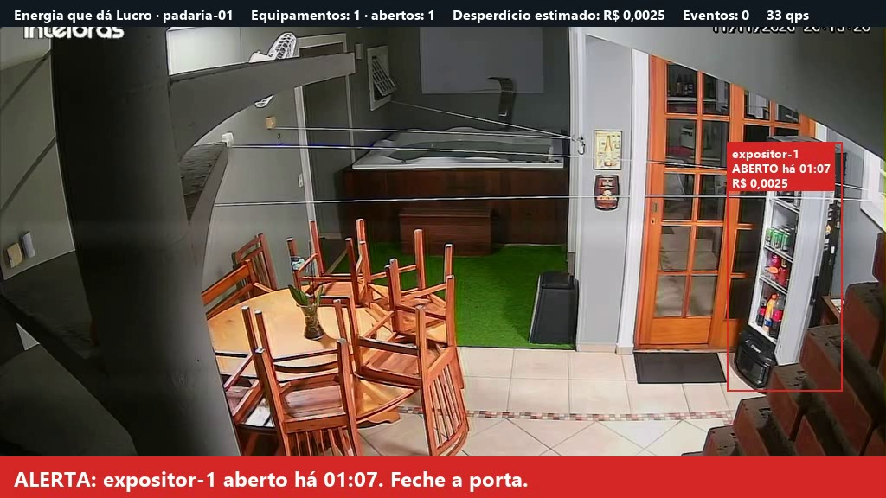

# ⚡ Energia que dá Lucro · Visão Computacional

Detecção em tempo real de **portas de geladeiras e freezers abertas** em pequenos comércios, usando as
câmeras de segurança que a loja já tem. Cada porta esquecida aberta vira um alerta na hora e um evento
com o custo estimado do desperdício.

Entrega da disciplina **Applied Computer Vision** · FIAP · Global Solution 2026.2 · CitizenTech · 4ES

## 👥 Integrantes

| Nome | RM |
|---|---|
| Gustavo Henrique Santos Bonfim | RM98864 |
| João Pedro Marques | RM98307 |
| Kayky Paschoal Ribeiro | RM99929 |
| Lucas Yuji Farias Umada | RM99757 |
| Natan Eguchi dos Santos | RM98720 |

## 🔗 Links

- 🎬 **Vídeo de demonstração:** https://youtu.be/wyOPgvcwENY
- 📄 **Relatório:** [docs/relatorio.pdf](docs/relatorio.pdf)
- 💻 **Repositório:** https://github.com/Natan-TI/acv-energia

## 📋 Ficha Técnica do MVP

| Campo | Conteúdo |
|---|---|
| Nome do produto | Energia que dá Lucro |
| Cidadão e território | Donos e funcionários de pequenos comércios de bairro (mercadinhos, padarias, açougues, lojas) em cidades brasileiras. |
| Problema, em uma frase | O pequeno comerciante paga caro de energia sem saber quais hábitos e equipamentos causam o desperdício. |
| Proposta de valor | Mostrar o desperdício em reais, avisar na hora em que ele acontece e sugerir ações simples, usando as câmeras que a loja já tem. |
| Arquitetura: componentes | Detecção por câmera (Visão, este repositório) · robô com sensores (Físico) · API e painel do comerciante (Produção) · pipeline de dados (Dados) · consultor de eficiência com LLM local (Inteligência) · alertas e resumos automáticos (Automação) · modelo de negócio (Pitch). |
| Fontes de dados | Imagens coletadas pela equipe em residências e comércios, com autorização. |
| Modelos de IA utilizados | YOLO11n (Ultralytics) com ajuste fino para quatro classes de porta de refrigeração. |
| URL do MVP e repositório | Repositório: https://github.com/Natan-TI/acv-energia · Vídeo: https://youtu.be/wyOPgvcwENY |
| Indicadores de impacto | R$ e kWh de desperdício evitados por loja ao mês · tempo médio de porta aberta · percentual de alertas resolvidos em poucos minutos. |
| ODS conectados | ODS 7 (energia acessível e limpa), ODS 12 (consumo responsável), ODS 9, ODS 11 e ODS 13. |

## ⚙️ Como funciona

1. A câmera (webcam, vídeo gravado ou câmera de rede) entrega os quadros.
2. O modelo YOLO detecta cada equipamento e diz se a porta está aberta ou fechada.
3. As regras de negócio (`src/monitor.py`) acompanham cada equipamento ao longo do tempo:
   - ignoram oscilações rápidas do modelo;
   - contam há quanto tempo cada porta está aberta;
   - disparam o alerta visual e sonoro depois do limite configurado (60 segundos por padrão);
   - opcionalmente, não alertam enquanto há um cliente na frente da geladeira.
4. Quando a porta fecha, é gravado um evento com a duração e o custo estimado.

Classes detectadas: `geladeira_aberta`, `geladeira_fechada`, `freezer_aberto`, `freezer_fechado`.

### Evento gerado

Um evento por linha, em `eventos/eventos-AAAA-MM-DD.jsonl`, no formato combinado pelo grupo:

```json
{"id": "3f2b6c1e-8a4d-4e0b-9d53-0c7a1e5b9f20", "loja_id": "padaria-01", "equipamento_id": "expositor-2",
 "tipo": "porta_aberta", "origem": "acv", "inicio": "2026-11-12T14:03:10-03:00",
 "duracao_s": 95, "custo_estimado_rs": 0.0036}
```

O custo é uma estimativa: `potência (kW) × fator de perda × horas × tarifa (R$/kWh)`. Os valores ficam em
`config.yaml`. **Os valores atuais são provisórios e não têm fonte.**

## 📁 Estrutura

```
config.yaml            classes, regras de alerta e parâmetros de custo
src/app.py             aplicação em tempo real
src/monitor.py         regras de negócio (estado das portas, alertas, eventos, custo)
src/hud.py             desenho das caixas, cronômetros e alertas sobre o vídeo
src/eventos.py         gravação dos eventos e envio opcional para a API do painel
src/extrair_frames.py  extrai imagens dos vídeos para anotação
src/resumo.py          resumo dos eventos gravados
notebooks/treino.ipynb treino e avaliação do modelo
models/best.pt         modelo treinado
results/               gráficos e métricas de cada versão do modelo
data/amostras/         algumas imagens de exemplo do conjunto
docs/                  guia de coleta e anotação, e base do relatório
tests/                 testes automáticos
```

## 🛠️ Instalação

Requer Python 3.10 ou mais recente. Para treinar, uma placa de vídeo NVIDIA ajuda muito.

```bash
python -m venv .venv
```

```bash
.venv\Scripts\activate
```

Instale o PyTorch com suporte à sua placa de vídeo (o comando abaixo serve para placas NVIDIA recentes;
veja outras opções em https://pytorch.org/get-started/locally/):

```bash
pip install torch torchvision --index-url https://download.pytorch.org/whl/cu128
```

```bash
pip install -r requirements.txt
```

## ▶️ Uso

### 1. Extrair imagens dos vídeos

Coloque os vídeos em `data/videos/` e rode:

```bash
python src/extrair_frames.py --entrada data/videos --saida data/frames --borrar-rostos
```

O passo a passo de coleta e anotação está em [docs/guia-coleta.md](docs/guia-coleta.md).

### 2. Treinar

Descompacte o conjunto anotado em `data/dataset/` e rode o notebook [notebooks/treino.ipynb](notebooks/treino.ipynb)
(no VS Code, no Jupyter ou no Google Colab). Ao final, o modelo fica em `models/best.pt`.

### 3. Rodar a detecção

```bash
python src/app.py
```

```bash
python src/app.py --fonte data/videos/teste.mp4 --salvar results/demo.mp4
```

| Opção | Para quê |
|---|---|
| `--fonte` | Número da webcam (`0`), arquivo de vídeo ou endereço da câmera de rede |
| `--salvar` | Grava o vídeo com as marcações |
| `--loja` | Troca o `loja_id` dos eventos |
| `--sem-janela` | Não abre janela (útil para só gravar) |
| `--sem-som` | Desliga o alerta sonoro |
| `--enviar` | Envia cada evento para a API do painel (`POST /events`), com a chave em `PAINEL_API_KEY` |

Teclas: `Q` ou `Esc` para sair.

### 4. Ver o resumo dos eventos

```bash
python src/resumo.py
```

## 🧪 Testes

```bash
python -m pytest
```

Os testes cobrem as regras de negócio e a aplicação de ponta a ponta com um vídeo sintético e um
detector falso. Eles não precisam de câmera, de GPU nem do modelo treinado.

## 🩹 Problemas conhecidos

**"WinError 206: O nome do arquivo ou a extensão é muito grande"** ao importar o PyTorch: o projeto está em uma
pasta de caminho longo e algum arquivo do ambiente `.venv` passou do limite de 260 caracteres do Windows.
Mova o projeto para um caminho curto (por exemplo, dentro de `Documents`) e recrie o `.venv` lá.
Ambientes Python não funcionam depois de movidos.

**"Fatal Error: HW capability found ... but HW capability requested: 0x200000"** durante o treino: acontece em
computadores com Windows que têm a variável de sistema `OPENSSL_ia32cap` definida. O notebook e a aplicação
já removem essa variável do próprio processo. Se você treinar pela linha de comando (`yolo detect train ...`),
rode antes, no mesmo terminal do PowerShell: `Remove-Item Env:OPENSSL_ia32cap`.

## 📊 Resultados

Conjunto de 472 imagens anotadas (1.132 com aumento de dados), YOLO11n com ajuste fino por 100 épocas.
Métricas no conjunto de teste (48 imagens):

| Precisão | Recall | mAP50 | mAP50-95 | Tempo por imagem (RTX 5070) |
|---|---|---|---|---|
| 0,965 | 0,914 | 0,955 | 0,813 | 6,1 ms |

Em cinco vídeos reservados, que não entraram no treino, a aplicação detectou a abertura da porta e gravou
um evento em cada um. Os detalhes estão em [docs/relatorio.md](docs/relatorio.md) e os gráficos em `results/v1/`.



## 🔒 Privacidade (LGPD)

- O processamento é feito no computador da loja.
- Nenhuma imagem é armazenada ou enviada pela aplicação: só os eventos (equipamento, horário, duração e custo).
- O modelo não identifica pessoas. A detecção opcional de pessoas só verifica se há alguém na frente do equipamento.
- Os vídeos usados no treino foram gravados com autorização e não fazem parte do repositório.

## 🤝 IA responsável

O sistema só avisa. Quem decide fechar a porta é o comerciante. O custo mostrado é uma estimativa, e os
parâmetros usados no cálculo ficam visíveis em `config.yaml`.

## ⚠️ Limitações conhecidas

- A maior parte das imagens vem de uma única geladeira doméstica, e não há gravações dentro de um comércio.
- Há poucos exemplos de freezer aberto em relação às outras classes.
- O conjunto não tem imagens sem equipamento, então o modelo pode apontar uma geladeira onde não há.
- As imagens de teste vêm dos mesmos vídeos do treino, o que deixa as métricas otimistas.
- O custo estimado usa parâmetros provisórios, sem medição real.

## 📜 Licenças

Este projeto usa o Ultralytics YOLO, distribuído sob a licença AGPL-3.0.
