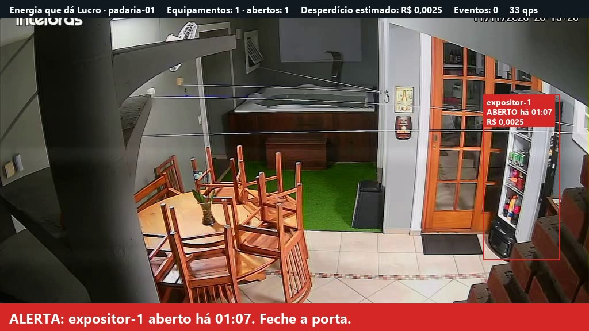
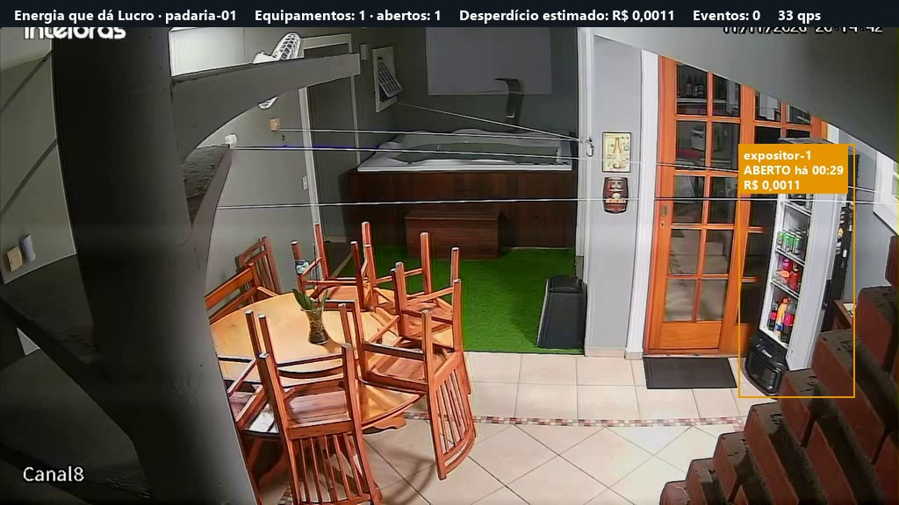
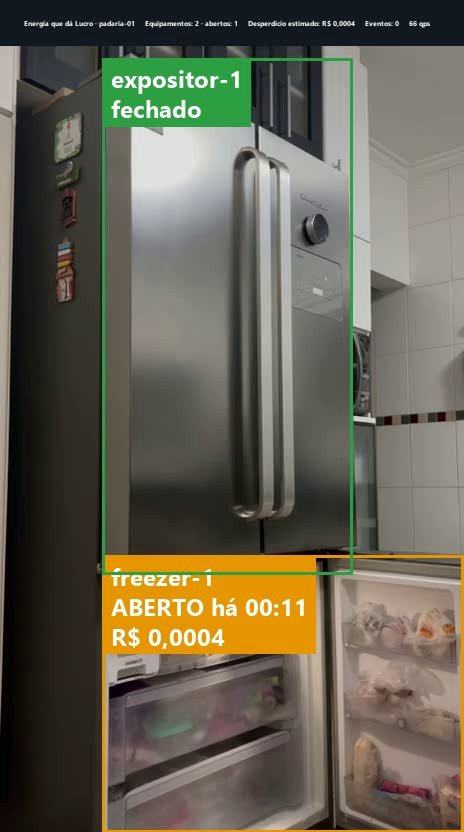
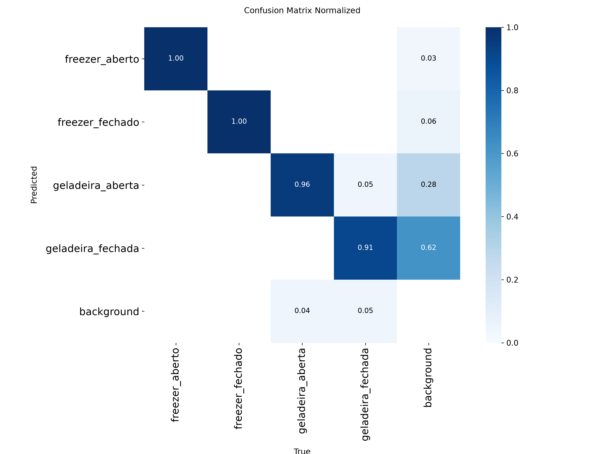
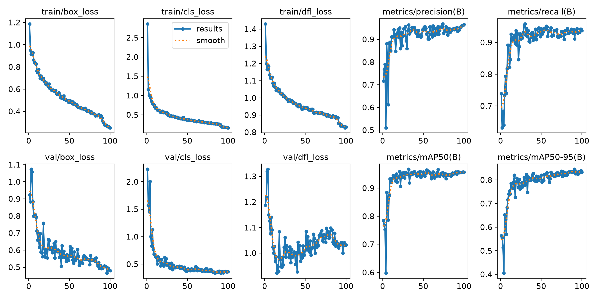
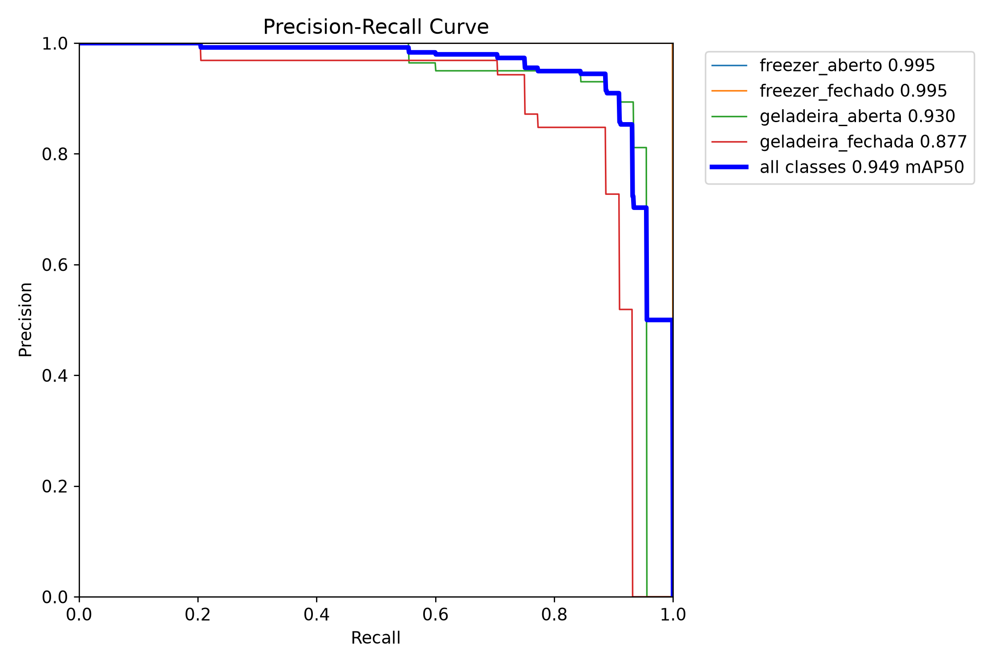
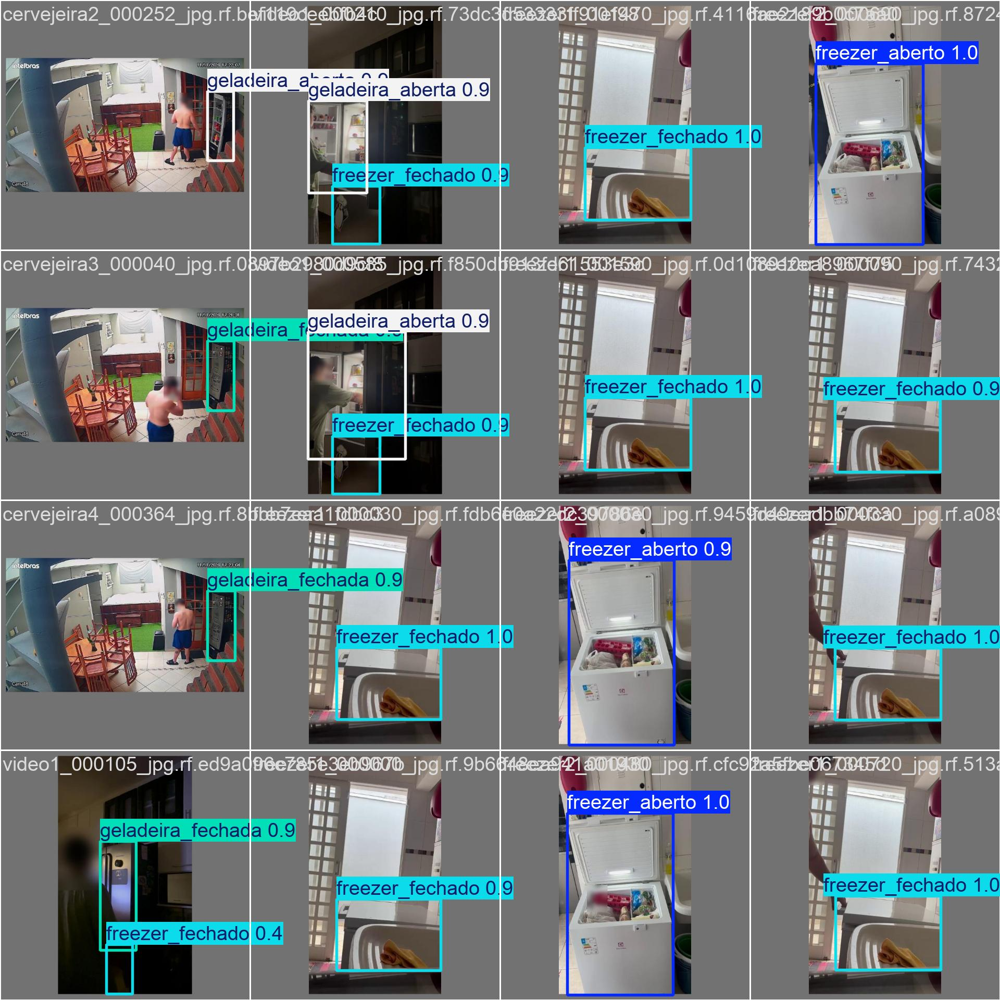

# Energia que dá Lucro: detecção em tempo real de portas de refrigeração abertas no comércio de bairro

FIAP · Engenharia de Software · 4ES · Global Solution 2026.2 · CitizenTech · Applied Computer Vision

## Integrantes

- Gustavo Henrique Santos Bonfim · RM98864
- João Pedro Marques · RM98307
- Kayky Paschoal Ribeiro · RM99929
- Lucas Yuji Farias Umada · RM99757
- Natan Eguchi dos Santos · RM98720

## Resumo

Pequenos comércios de bairro mantêm geladeiras, expositores e freezers ligados o dia inteiro, e uma porta
esquecida aberta aumenta o consumo de energia sem que o comerciante perceba. Esse desperdício não aparece
separado na conta de luz, então raramente é corrigido.

Este trabalho apresenta o componente de visão computacional do produto Energia que dá Lucro. Ele usa a
imagem de uma câmera comum para detectar, em tempo real, portas de refrigeração abertas, cronometrar cada
abertura, avisar quando o tempo passa de um limite e registrar um evento com a duração e o custo estimado.

Foram gravados 19 vídeos de quatro tipos de equipamento, dos quais saíram 472 imagens anotadas no Roboflow
em quatro classes: geladeira aberta, geladeira fechada, freezer aberto e freezer fechado. Com aumento de
dados, o conjunto chegou a 1.132 imagens. O modelo YOLO11n, pré-treinado, recebeu ajuste fino por 100
épocas em uma placa de vídeo local.

No conjunto de teste, o modelo atingiu precisão de 0,965, recall de 0,914, mAP50 de 0,955 e mAP50-95 de
0,813, processando cada imagem em 6,1 milissegundos. Em cinco vídeos reservados, nunca vistos no treino,
a aplicação identificou corretamente a abertura da porta e gerou um evento em cada um.

O objetivo foi atingido para os equipamentos gravados. A principal limitação é a variedade do conjunto:
a maior parte das imagens vem de uma única geladeira doméstica, e ainda não há gravações dentro de um
comércio. As métricas de teste também são otimistas, porque as imagens de teste vêm dos mesmos vídeos
usados no treino.

## Introdução

Pequenos mercados, padarias e lojas de bairro dependem de geladeiras, expositores e freezers ligados o
dia inteiro. Uma porta esquecida aberta faz o equipamento trabalhar mais para manter a temperatura,
aumenta o consumo de energia e pode comprometer a conservação dos produtos. O comerciante raramente
percebe esse desperdício, porque ele não aparece separado na conta de luz.

A energia pesa no caixa desses negócios. Segundo levantamento do Sebrae com 669 pequenos negócios de 14
estados, o gasto com a conta de luz pode chegar a 10% do faturamento da empresa, e metade dos pequenos
negócios só se lembra da energia quando a conta chega (SEBRAE, 2024). O mesmo levantamento aponta que a
principal barreira para investir em eficiência é a falta de conhecimento ou de confiança na tecnologia,
citada por 31% dos empresários, seguida pela necessidade de alto investimento, citada por 28%. Entre as
recomendações do Sebrae para reduzir a conta estão o treinamento da equipe e o uso de automação e sensores.

Este trabalho faz parte do produto Energia que dá Lucro, desenvolvido para o desafio CitizenTech da FIAP.
O componente de visão computacional usa as câmeras de segurança que a loja já possui para detectar, em
tempo real, portas de refrigeração abertas, avisar o comerciante e registrar quanto tempo cada porta
ficou aberta e quanto isso custou.

## Objetivo

Treinar um modelo de detecção de objetos capaz de identificar, em tempo real, geladeiras e freezers com
a porta aberta em imagens de câmeras de pequenos comércios, e transformar essas detecções em alertas e
em eventos com duração e custo estimado do desperdício de energia.

## Explicação técnica das ferramentas

- **YOLO11 (Ultralytics):** família de modelos de detecção de objetos de estágio único, que localiza e
  classifica os objetos em uma única passagem pela rede, o que permite uso em tempo real. Foi usado o
  modelo `yolo11n`, o menor da família, pré-treinado no conjunto COCO.
- **Ajuste fino (transfer learning):** o treino parte dos pesos pré-treinados e os ajusta para as quatro
  classes do projeto, o que exige muito menos imagens do que treinar do zero.
- **Roboflow:** anotação das caixas, divisão em treino, validação e teste, e aumento de dados.
- **PyTorch com GPU:** execução do treino em uma NVIDIA GeForce RTX 5070 de 12 GB. As 100 épocas levaram
  cerca de 22 minutos.
- **OpenCV:** leitura da câmera ou do vídeo, extração de quadros e exibição.
- **Pillow:** desenho dos textos sobre o vídeo.
- **Regras de negócio em Python:** associação de cada detecção a um equipamento fixo pela posição da caixa,
  filtro de oscilações, cronômetro por porta, alerta e geração de eventos.
- **pytest:** testes automáticos das regras e da aplicação.

## Metodologia

1. **Definição das classes:** `geladeira_aberta`, `geladeira_fechada`, `freezer_aberto`, `freezer_fechado`.
   Uma geladeira com freezer conta como dois compartimentos, cada um com a sua caixa e o seu estado.
2. **Coleta:** 19 vídeos de treino, gravados pela equipe, de quatro tipos de equipamento: uma geladeira
   doméstica com gaveta de freezer embaixo (12 vídeos), um freezer (2 vídeos), um frigobar (2 vídeos) e uma
   cervejeira vista por uma câmera de segurança (3 vídeos). Outros cinco vídeos foram reservados e não
   entraram no treino.
3. **Extração de quadros:** uma imagem a cada 0,5 segundo, descartando as quase iguais à anterior e
   borrando rostos (`src/extrair_frames.py`). Depois da limpeza manual, restaram 472 imagens.
4. **Anotação:** no Roboflow, com caixas cobrindo o compartimento inteiro; porta entreaberta conta como
   aberta. Todas as 472 imagens têm pelo menos um equipamento anotado.
5. **Divisão e aumento de dados:** 330 imagens para treino, 94 para validação e 48 para teste (70%, 20% e
   10%). As imagens foram redimensionadas para 640×640. Cada imagem de treino gerou três versões, com
   variação de brilho (±20%), exposição (±10%), rotação (±5°) e desfoque (até 1 px), somando 990 imagens
   de treino e 1.132 no total.

   | Classe | Treino (com aumento) | Validação | Teste |
   |---|---|---|---|
   | `geladeira_aberta` | 402 | 45 | 19 |
   | `geladeira_fechada` | 501 | 44 | 27 |
   | `freezer_aberto` | 162 | 7 | 3 |
   | `freezer_fechado` | 414 | 51 | 25 |

6. **Treino:** `yolo11n`, imagens de 640 px, 100 épocas, com parada antecipada configurada para 20 épocas
   sem melhora. A parada antecipada não foi acionada: o treino rodou as 100 épocas.
7. **Análise dos erros:** com o limiar de confiança usado pela aplicação (0,5), o número de detecções do
   modelo coincide com o número de anotações em 123 das 142 imagens de validação e de teste. A classe mais
   fraca é `geladeira_fechada` (mAP50 de 0,865 no teste). A matriz de confusão salva pelo treino mostra
   muitas detecções a mais de `geladeira_fechada` e `geladeira_aberta`, mas elas têm confiança baixa e
   são descartadas pelo limiar de 0,5.
8. **Aplicação em tempo real:** as detecções passam pelas regras de negócio, que mantêm o estado de cada
   porta, disparam o alerta depois de 60 segundos e registram o evento quando a porta fecha.
9. **Validação em vídeos não vistos:** a aplicação foi executada nos cinco vídeos reservados (três da
   geladeira doméstica e dois da cervejeira pela câmera de segurança). Em todos, a abertura da porta foi
   detectada e um evento foi gravado. Em um deles, a porta ficou aberta por mais de 60 segundos e o
   alerta disparou.

Foi treinada uma única versão do modelo. Não houve segunda rodada de coleta e treino.

## Exemplos de resultados

### Métricas no conjunto de teste (48 imagens)

| Precisão | Recall | mAP50 | mAP50-95 |
|---|---|---|---|
| 0,965 | 0,914 | 0,955 | 0,813 |

| Classe | mAP50 | mAP50-95 |
|---|---|---|
| `freezer_aberto` | 0,995 | 0,995 |
| `freezer_fechado` | 0,995 | 0,921 |
| `geladeira_aberta` | 0,966 | 0,698 |
| `geladeira_fechada` | 0,865 | 0,639 |

O resultado de `freezer_aberto` se apoia em apenas 3 exemplos de teste e não é confiável isoladamente.

Na validação, ao final da última época: precisão de 0,966, recall de 0,937, mAP50 de 0,957 e mAP50-95
de 0,833.

### Velocidade

O modelo leva 6,1 ms por imagem na RTX 5070, o equivalente a 164 quadros por segundo. A aplicação
completa, com leitura do vídeo, regras e desenho na tela, rodou a cerca de 66 quadros por segundo.

### Vídeos reservados

| Vídeo | Equipamento detectado | Tempo aberto | Custo estimado |
|---|---|---|---|
| `video13` | freezer-1 | 21 s | R$ 0,0008 |
| `video14` | expositor-1 | 19 s | R$ 0,0007 |
| `video15` | expositor-1 | 17 s | R$ 0,0006 |
| `cervejeira1` | expositor-1 | 10 s | R$ 0,0004 |
| `cervejeira_alerta` | expositor-1 | 74 s | R$ 0,0028 |

No vídeo `cervejeira_alerta`, a porta ficou aberta por 74 segundos. O alerta visual e sonoro disparou
aos 60 segundos e permaneceu até a porta fechar.







Exemplo de evento gravado:

```json
{"id": "075e6523-7966-4e52-ac7a-9a3a0b92e642", "loja_id": "padaria-01", "equipamento_id": "freezer-1",
 "tipo": "porta_aberta", "origem": "acv", "inicio": "2026-11-11T19:31:51-03:00", "duracao_s": 21,
 "custo_estimado_rs": 0.0008}
```

O custo usa parâmetros provisórios de potência, perda e tarifa, definidos em `config.yaml` e sem fonte.

### Gráficos do treino



A matriz é calculada com um limiar de confiança muito baixo, por isso mostra detecções a mais de geladeira
na coluna de fundo. Com o limiar de 0,5 usado pela aplicação, essas detecções são descartadas.







### Limite da avaliação

As imagens de teste vêm dos mesmos vídeos das imagens de treino, e imagens vizinhas de um vídeo são muito
parecidas. Por isso as métricas tendem a ser mais altas do que o desempenho em um local novo, e o
resultado nos vídeos reservados também é apresentado.

## Conclusão

O objetivo foi atingido para os equipamentos gravados: o modelo detecta os quatro estados com mAP50 de
0,955 no teste, roda muito acima do necessário para tempo real e funcionou nos cinco vídeos que não
participaram do treino, incluindo a imagem de uma câmera de segurança.

Limitações:

- **Pouca variedade:** 12 dos 19 vídeos mostram a mesma geladeira doméstica, e não há gravações dentro de
  um comércio. O desempenho em expositores comerciais é desconhecido.
- **Poucos exemplos de freezer aberto:** 172 no conjunto com aumento, contra 414 a 572 das outras classes.
- **Sem imagens de fundo:** nenhuma imagem do conjunto está sem equipamento, então o modelo pode apontar
  uma geladeira onde não há.
- **Métricas otimistas:** pelo motivo descrito em "Limite da avaliação".
- **Custo estimado sem calibração:** os parâmetros do cálculo não vêm de medição nem de fonte.

Próximos passos: gravar em dois ou três comércios, incluir imagens sem equipamento, calibrar o custo com
medição real de consumo e integrar os eventos ao painel do comerciante e aos alertas por mensagem.

## Referências

- JOCHER, G.; QIU, J. Ultralytics YOLO11. 2024. Disponível em: https://github.com/ultralytics/ultralytics.
- Roboflow. Disponível em: https://roboflow.com.
- SEBRAE. Gasto com conta de luz chega a 10% do faturamento do pequeno negócio, aponta Sebrae. Agência
  Sebrae de Notícias, 29 jun. 2024. Disponível em:
  https://agenciasebrae.com.br/cultura-empreendedora/gasto-com-conta-de-luz-chega-a-10-do-faturamento-do-pequeno-negocio-aponta-sebrae/.
  Acesso em: 11 nov. 2026.
